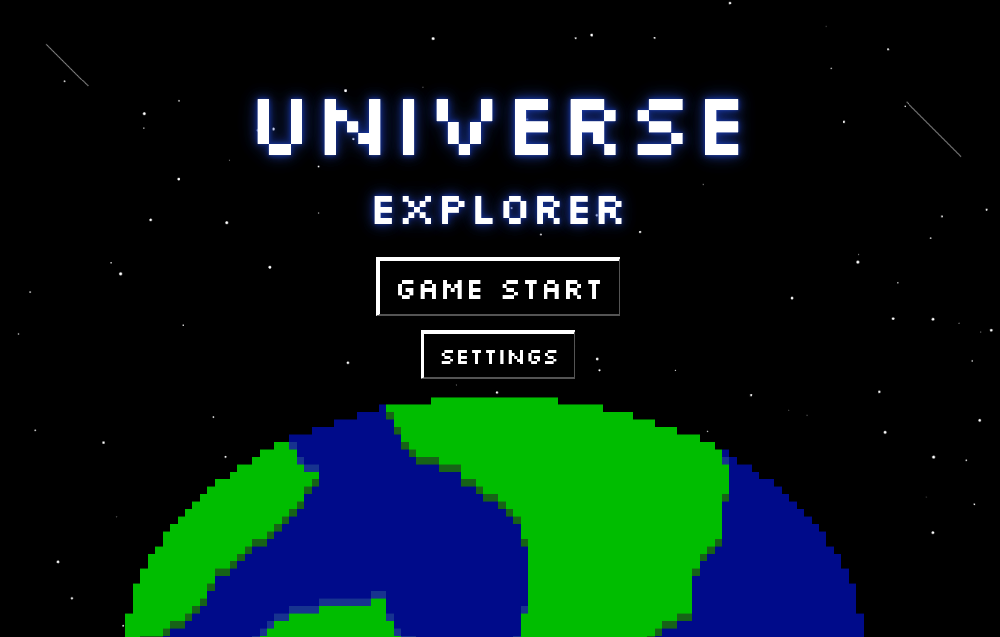
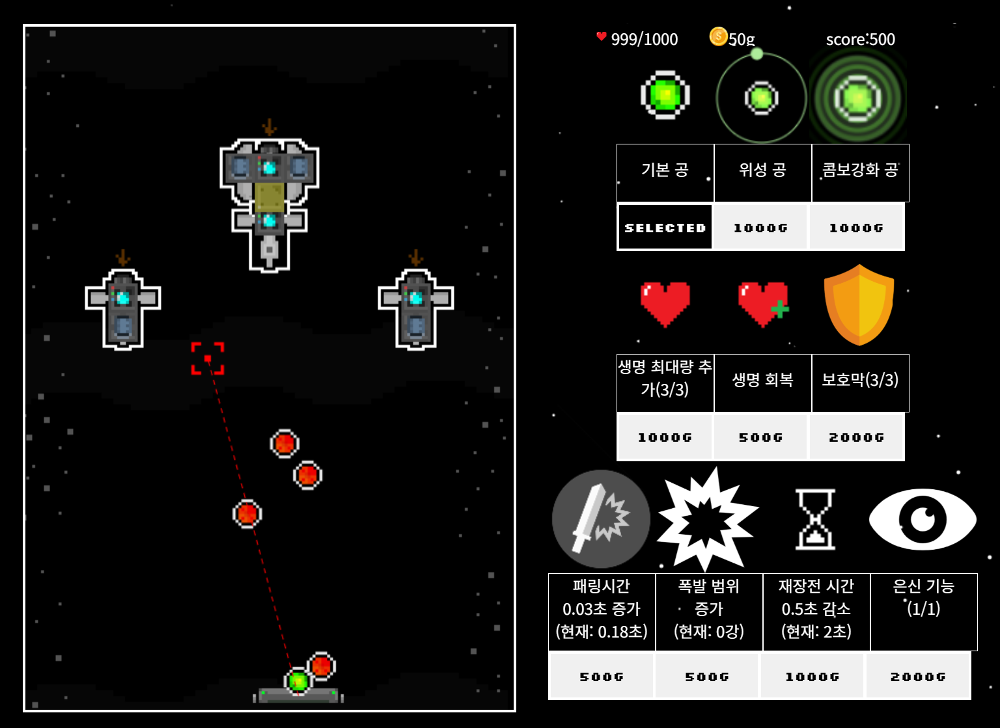
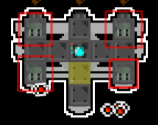
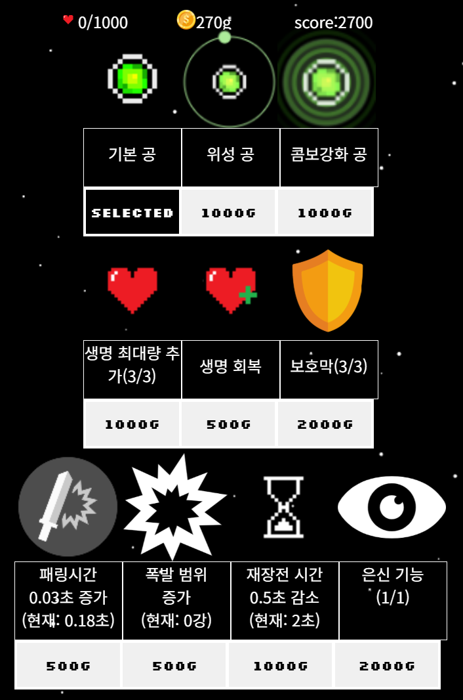

# Universe Explorer

Universe explorer는 벽돌깨기와 슈팅 게임을 결합한 싱글 플레이 게임입니다. html canvas와 javascript를 통해 개발되었습니다.

## 게임 콘셉트

플레이어는 우주공간에서 몰려오는 적 함선들과 맞서 싸우게 됩니다.
적 함선은 플레이어에게 붉은 총알을 발사하며, 플레이어는 이를 좌우로 움직여 피할 수 있습니다.

핵심 특징은, **플레이어의 총알을 마치 벽돌깨기에서의 공 처럼 조작**하게 된다는 점입니다.
플레이어가 자신의 총알과 부딫히면, 총알은 **마우스 포인터가 가리키는 방향**으로 날아갑니다.
이를 적 함선과 부딫히게 하여, 적 함선에게 피해를 줄 수 있습니다.

## 조작법
* A: 왼쪽으로 이동
* D: 오른쪽으로 이동
* 마우스 왼쪽 클릭: 패링
* ESC: 일시 정지

플레이어 근처에 총알이 다가올 때, 적절한 타이밍에 마우스 왼쪽 클릭을 하면 **패링**을 할 수 있습니다.
* 적의 총알을 패링할 경우: 플레이어가 피해를 입지 않고 총알을 튕겨냅니다.
* 플레이어의 총알을 패링할 경우: 플레이어의 총알이 **강화**됩니다. 강화된 공은 적에게 폭발 피해를 주어, 적의 '벽돌'을 더 많이 부숩니다. 패링을 연속으로 성공하면 콤보가 쌓이고, 콤보가 쌓일수록 폭발 피해가 커집니다.

## 적 캐릭터

다양한 적 캐릭터가 존재하며, 플레이어를 향해 총알을 발사합니다. 
플레이어가 적의 총알과 부딫히면 체력이 감소하고, 0이 되면 게임 오버입니다.

적 캐릭터는 정사각형 **벽돌**들로 구성되며, 그 중 하늘색 빛을 띄는 것은 적의 **코어**입니다.
적을 무찌르려면 플레이어의 총알을 적을 향해 튕겨내어, 적의 코어를 부숴야 합니다.

## 상점

상점에서 골드로 전투에 도움이 되는 아이템을 구매할 수 있습니다. 
골드는 적의 벽돌을 부술 때마다 증가합니다.

ESC로 게임을 일시 정지해도 상점 이용이 가능하며, 마우스 클릭으로 구매할 아이템을 선택하면 됩니다.

## 플레이 방법

리포지터리를 `git clone` 등으로 다운로드하고, `webProj.html` 파일을 열면 게임이 시작됩니다.

게임은 총 세 스테이지로 구성되며, 3스테이지를 깨면 게임 클리어입니다.

메인 메뉴에서 GAME START 버튼을 클릭한 뒤, EASY/NORMAL/HARD 중 하나를 선택하면 스테이지가 시작됩니다.
EASY/NORMAL/HARD 는 사실 게임 스테이지 선택입니다. 각각 1/2/3 스테이지부터 시작하도록 합니다.
EASY를 선택하여 스테이지 1부터 시작하는 것을 권장합니다.